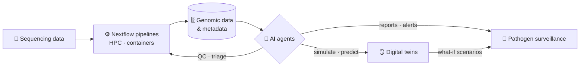

---

## 👋 Who I Am

<h3>Hi, I'm Daniel 🧬</h3>

Bioinformatician focused on <b>pathogen surveillance</b>, <b>reproducible workflows</b> and <b>bioinformatics infrastructure</b> — now bringing <b>AI agents</b> into genomics platforms and exploring <b>digital twins</b> for the life sciences.

<ul>
  <li>🔭 Building Nextflow pipelines, APIs and HPC-based bioinformatics platforms.</li>
  <li>🤖 Integrating <b>AI agents</b> into bioinformatics, genomics and life-science infrastructure: workflow orchestration, data QC, reporting and lab automation.</li>
  <li>🪞 Exploring <b>digital twins</b> of biological systems, labs and surveillance networks.</li>
  <li>🧪 Interested in health genomics, automation and scalable data analysis.</li>
  <li>💬 Ask me about bioinformatics, Nextflow, HPC, Python, AI agents or genomics infrastructure.</li>
</ul>

<table align="center">
  <tr>
    <td valign="top" width="50%">

<h3>🛠️ Tech Stack</h3>

<b>Languages</b> 
  
  
  
  

<b>Workflows & Infra</b> 
  
  
  
  
  
  
  

<b>Backend & AI</b> 
  
  
  
  
  

</td>
<td valign="top" width="50%">

<h3>🧬 Main Interests</h3>

  
  
  
  
  
  
  
  

</td>
  </tr>
</table>

---

## 🤖 Where I'm Heading

> From raw reads to decisions: reproducible pipelines + AI agents + digital twins.

<table>
  <tr>
    <td width="33%" valign="top">
      <h4>⚙️ Infrastructure</h4>
      Scalable, reproducible genomics platforms: Nextflow, containers, HPC schedulers and APIs that labs can actually rely on.
    </td>
    <td width="33%" valign="top">
      <h4>🤖 AI Agents</h4>
      Agents that launch and monitor pipelines, check QC, query genomic databases and draft reports — with humans in the loop.
    </td>
    <td width="33%" valign="top">
      <h4>🪞 Digital Twins</h4>
      Virtual models of labs, patients or surveillance networks to simulate scenarios and support decisions in life sciences.
    </td>
  </tr>
</table>

---

## 📊 GitHub Stats

<!-- Option A: if you generate your own stats card (like the screenshot) with a GitHub Action, point to it here: -->
<!--  -->

---

## 🌍 Notable Open-Source Contributions

  
  

---

## 📫 Let's Connect

  

<i>🧬 Always happy to talk about genomics infrastructure, AI agents in the lab, or digital twins for health.</i>

